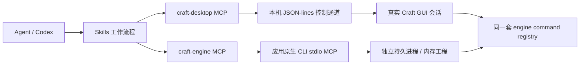

# ArtCraft Agent 本地插件

这是面向 **Codex 桌面/CLI 的本地插件**，包含 7 个 skills、2 个 stdio MCP。已在本机 macOS 上安装启用。它不需要 OpenAI API key，也不调用远程生成服务。

公开仓库：[bansenbingo/Artcraftplugin](https://github.com/bansenbingo/Artcraftplugin)。完整插件包位于 [dist/artcraft-agent-plugin.zip](dist/artcraft-agent-plugin.zip)，SHA256 校验文件与 ZIP 放在同一目录。仓库包含源码、skills、MCP 配置、文档、测试及测试记录；运行环境、软件二进制和控制凭据保存在用户目录，需通过 setup 脚本另行准备。

这里交付的是本地 MCP+skills 包，已通过本机 Codex CLI 实际安装验证。ChatGPT 网页接入需要另行提供它可连接的受保护远程 MCP 服务和相应应用配置。本项目没有部署远程端点，也未发布 ChatGPT App。

## 怎么实现 Agent 直接控制



桌面模式可看到窗口随着操作改变；独立引擎模式适合无窗口批处理。两者拥有不同的工程，不能混为同一份文档。代码根据每个仓库真实的参数解析、控制通道和命令分发实现，不通过屏幕坐标猜测整套功能。

详见 [源码核对与各应用启动命令](references/protocols.md)。每条来源固定到 Git commit，JSON 记录在 [sources.json](references/sources.json)。官网七款主要应用全部有适配，此外支持 WordCraft、GridCraft、DeckCraft、SoundCraft、CADCraft；实际可用功能仍取决于安装版本。

## 本机安装与使用

当前插件名：`artcraft-agent@artcraft-local`。重新打开 Codex 或创建新聊天，让新插件的 skills 和 MCP 被加载。可以直接说：

> 使用 ArtCraft Agent 检查本机软件，连接 PhotoCraft，创建 1280×720 图像，预览并保存到 CraftAgent 文件夹。

> 使用 craft-photos，连接 LightCraft，把我指定的照片曝光提高 0.5，先预览，再导出新文件。

> 使用 craft-office，在 GridCraft 写入表格和公式，读取计算结果并保存 xlsx。

迁移到另一台 macOS：克隆仓库（或解压 dist 中的插件包），执行以下命令：

```sh
git clone https://github.com/bansenbingo/Artcraftplugin.git
cd Artcraftplugin
python3 scripts/setup.py
codex plugin marketplace add "$PWD"
codex plugin add artcraft-agent@artcraft-local
```

本机源码已迁移到 `/Users/teddyjiang/Documents/Github/Artcraftplugin`，本地 marketplace 的来源路径也已更新。原有 runtime 和工作目录不随源码迁移，已安装插件继续使用原来的配置。

setup 安装固定版本的 Python MCP SDK 到独立 venv，首次安装需要网络；MCP 启动本身不下载、不安装依赖。依赖锁定在 requirements-lock.txt。Python 需要 3.11+；已验证 Python 3.12。当前打包的启动脚本面向 macOS/POSIX，Windows 用户应直接注册上游 native MCP，或另行适配 Python 管道启动器。

## 两个 MCP

`craft-desktop`：

- craft_status：安装路径、软件版本、CLI 和控制端口状态。
- craft_launch：启动控制会话，等待真实 UI 响应。
- craft_list_commands：搜索/分页命令目录与参数说明。
- craft_inspect：读当前文档或 UI 状态。
- craft_command：执行当前应用的精确 engine command。
- craft_control：执行其原生 JSON 方法，例如 app.open/app.save/ui.key/ui.type。
- craft_screenshot：返回 MCP PNG 图像，按需保存截图。

`craft-engine`：

- craft_engine_status：查询 CLI 安装。
- craft_engine_tools：启动/复用原生 CLI MCP，并返回搜索后的精确工具 schema。
- craft_engine_call：调用原生工具，保留图片、structuredContent 和 isError。
- craft_engine_reset：明确丢弃当前独立引擎内存会话。

发现目录不会自动推断命令参数。不同软件使用的工具名并不相同：GridCraft 是 execute_command/set_cell，LightCraft 是 set_develop 等。插件不硬编码成统一 command_run。批处理是否原子、渲染是否异步以原生工具为准。独立代理不转发 MCP progress/cancellation 或 resources/sampling；需要这些功能可以直接配置上游 native MCP。

## 文件夹与配置

- 默认工作目录：`~/Documents/CraftAgent`。
- 用户配置：`~/.config/artcraft-agent/config.json`。
- Python 和 CLI：`~/.local/share/artcraft-agent/`。
- 控制凭据和诊断日志：上述目录的 `run/`；凭据不进入插件包或工具输出。

配置示例：

```json
{
  "workspace": "/absolute/path/to/project",
  "apps": {
    "lightcraft": {
      "library": "/absolute/path/to/gui-library",
      "cli": "/absolute/path/lightcraft-cli",
      "headless_args": ["--library", "/absolute/path/to/separate-library"]
    },
    "vectorcraft": {"port": 19002},
    "wordcraft": {"key_file": "/absolute/path/control-key.local-19008"}
  }
}
```

修改 workspace/路径后重建 MCP 连接；要改变已启动 GUI 的 roots，需要正常关闭该自动化实例后重新启动。不要给同一 LightCraft 图库同时启动 GUI 和独立引擎，它有目录锁。`scratch:true` 用于演示测试，LightCraft 是内存演示库，不代表用户图库。

PhotoCraft/VectorCraft 的桌面读写限于 workspace。PhotoCraft/VectorCraft/EffectCraft 的独立引擎用原生 roots；PdfCraft 独立引擎用 --root。**其他应用并未被插件实现文件系统沙箱**，拥有用户级原生权限。

## 配套 CLI

macOS 的 .app 通常只含 GUI，独立引擎需要单独 CLI。桌面 JSON 适配不依赖 CLI。

```sh
python3 /absolute/path/Artcraftplugin/scripts/setup.py --skip-runtime --install-cli lightcraft
```

下载与已安装 GUI 匹配的官方版本，并验证该 release 的 SHA256SUMS.txt。上游没有 universal 包时，从 release 页面取得适合架构的包并手动配置 cli，或在固定源码版本中构建：

```sh
cargo build --release -p photocraft-cli
cargo build --release -p vectorcraft-cli
cargo build --release -p filmcraft-cli
cargo build --release -p lightcraft-cli
cargo build --release -p pdfcraft-cli
cargo build --release -p effectcraft-cli
cargo build --release -p designcraft-cli
```

每条 cargo 命令在对应应用仓库执行。构建后把 target/release/<app>-cli 放在 runtime/bin，或配置 apps.<app>.cli。不需要复制任何 API 密钥到插件。

本机已准备 GridCraft CLI（固定 commit 编译）及 LightCraft CLI（官方 0.6.0 包、SHA256 校验通过）。其他 CLI 可按任务安装；未安装不会阻止两个 MCP 入口启动。

## 验证与限制

实际结果见 [验证报告](VALIDATION.md)。MCP 注册成功不代表应用功能已测试；报告区分真实 GUI 测试、原生引擎测试和源码适配。

可复现检查：

```sh
~/.local/share/artcraft-agent/venv/bin/python -m unittest discover -s /absolute/path/Artcraftplugin/tests -v
~/.local/share/artcraft-agent/venv/bin/python /absolute/path/Artcraftplugin/scripts/smoke_mcp.py
```

`--live` 会启动隔离端口的 GUI 实例并创建合成测试文件，只用于需要 GUI 验证时；普通检查不编辑桌面文档。软件可能要求窗口可见才能截图或处理输入。注入 egui 控件不等于验证操作系统键盘菜单或屏幕阅读器。

异常/超时后修改可能已完成；先 inspect 再重试，插件不自动重放编辑。客户端关闭会结束独立引擎并丢弃未保存工程。没有设置共享多客户端协作锁；多个聊天控制同一 GUI 时，优先显式对象 id，并在编辑前读当前状态。

本项目为非官方社区集成；ArtCraft/Craft 名称属于其原项目。上游各应用处于 alpha 或开发阶段，Agent-ready 不等于已具备 Adobe 全部功能。
